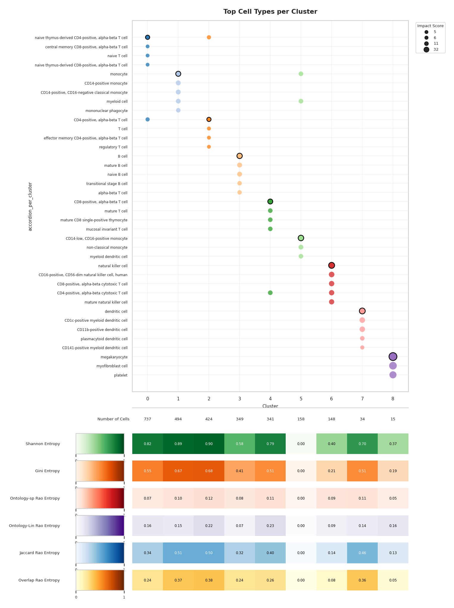

# The Cell Marker Accordion — Python

### Python package for automated annotation and interpretation of single-cell and spatial omics data.

## Overview

**pycellmarkeraccordion** is the Python implementation of the Cell Marker
Accordion (Busarello et al., Nature Communications, 2025). It annotates cell populations from the built-in Accordion database of
marker genes, reports which markers and which candidate cell types drove each
call.
A new key feature of these new implementation is the use of entropy metrics to quantifies biological heterogeneity.

## Installation

From a local clone of the repository:

```bash
pip install .
```

Python ≥ 3.12. The marker database and the Cell Ontology ship with the package;
nothing has to be downloaded.

## Loading the package

```python
import scanpy as sc
from pycellmarkeraccordion import accordion, plot_top_celltypes_per_cluster
```

## Input data

`accordion` takes an `AnnData` object (or the path to an `.h5ad`), with cells on
rows and genes on columns, holding raw or normalized counts. As an example we
use the Peripheral Blood Mononuclear Cells (PBMC) dataset freely available from
10X Genomics.

```python
adata = sc.read_10x_mtx("filtered_gene_bc_matrices/hg19/", var_names="gene_symbols")
sc.pp.filter_cells(adata, min_genes=200)
sc.pp.filter_genes(adata, min_cells=3)
```

Process and cluster the data:

```python
adata.layers["counts"] = adata.X.copy()
sc.pp.normalize_total(adata, target_sum=1e4)
sc.pp.log1p(adata)
sc.pp.highly_variable_genes(adata, n_top_genes=2000)
sc.pp.scale(adata)
sc.tl.pca(adata, n_comps=30)
sc.pp.neighbors(adata, n_neighbors=10, n_pcs=10)
sc.tl.leiden(adata, resolution=0.4, key_added="leiden")
sc.tl.umap(adata)
```

`adata.X`: `adata.X = adata.layers["counts"]`.

## Annotate at cluster resolution

Run `list_tissues()` to see which tissues the Accordion covers:

```python
from pycellmarkeraccordion import list_tissues
list_tissues(species="Human")[:20]
```

(`list_tissues()` with no argument covers both Human and Mouse.)

Then annotate. `cluster_info` is the name of the `adata.obs` column holding the
cluster labels:

```python
adata = accordion(adata, species="Human", tissue="blood",
                  cluster_info="leiden", annotation_resolution="cluster",
                  max_n_marker=30,
                  include_detailed_annotation_info=True)

sc.pl.umap(adata, color="accordion_per_cluster")
```

Two columns are added to `adata.obs`:

| column | content |
|---|---|
| `accordion_per_cluster` | the cell type assigned to each cell's cluster |
| `accordion_per_cluster_score` | the impact score of that assignment |

## Interpret the result

With `include_detailed_annotation_info=True`, the tables behind the annotation
are stored in `adata.uns`:

```python
info = adata.uns["accordion"]["detailed_annotation_info"]
sorted(info)
#> ['cluster_entropy_Gini', 'cluster_entropy_Jaccard-Rao', ...,
#>  'top_celltypes', 'top_markers_per_celltype_cluster', ...]

info["top_celltypes"].head()
```

`top_celltypes` lists, for every cluster, the top candidate cell types with
their impact score and the percentage of cells they account for;
`top_markers_per_celltype_cluster` lists the marker genes that contributed most
to each call.

The dot plot puts both on one figure: clusters on the x axis, candidates on the
y axis, dot area growing with the impact score, and the winning cell type of
each cluster ringed in black.

```python
plot_top_celltypes_per_cluster(adata, annotation_name="accordion",
                               cluster_color_key="leiden")
```

## Entropy metrics as a proxy of cellular heterogeneity

Set `entropy` when running `accordion`. `"all"` computes every metric, or pass
only the ones you need. The default is `"Overlap-Rao"`; `None` or `False` skips
the entropy altogether.

```python
adata = accordion(adata, species="Human", tissue="blood",
                  cluster_info="leiden", annotation_resolution="cluster",
                  max_n_marker=30,
                  entropy="all",
                  include_detailed_annotation_info=True)

info = adata.uns["accordion"]["detailed_annotation_info"]
info["cluster_entropy_Shannon"]
```

One table per metric, next to the rest of the detailed annotation information.
Entropy at cluster resolution requires `include_detailed_annotation_info=True`,
since it is computed from the candidate cell types and their impact scores.

### The six metrics

They answer two different questions, and are meant to be read together.

**How many candidates, and how evenly matched?** These two look only at the
distribution of the candidates' weights, not at who the candidates are.

| metric | range | notes |
|---|---|---|
| `Shannon` | 0–1 | normalised by `log2(n)`, so it does not grow just because a cluster has more candidates |
| `Gini` | 0–1 | reported raw (`1 - sum(p²)`), already bounded by 1 for any `n` |

**How different are the candidates from each other?** These are Rao's quadratic
entropies: they weight each pair of candidates by how far apart the two cell
types actually are.

| metric | range | distance between two cell types |
|---|---|---|
| `Ontology-sp-Rao` | 0–1 | shortest path on the Cell Ontology graph |
| `Ontology-Lin-Rao` | 0-1 | Lin semantic similarity on the Cell Ontology |
| `Jaccard-Rao` | 0-1 | overlap of their marker sets (Jaccard) |
| `Overlap-Rao` | 0-1 |overlap of their marker sets (overlap coefficient) |

### Visualising the output

The dot plot of the top cell types carries one heatmap row per entropy metric
underneath, so the label and how contested it was are read off the same columns:

```python
plot_top_celltypes_per_cluster(adata, annotation_name="accordion",
                               cluster_color_key="leiden")
```




Only the metrics actually present are drawn, so the figure adapts to having all
of them, some, or none. `show_entropy=False` gives the dot plot alone.

For any questions or issues please contact Gaia Faggin gaia.faggin@unitn.it
